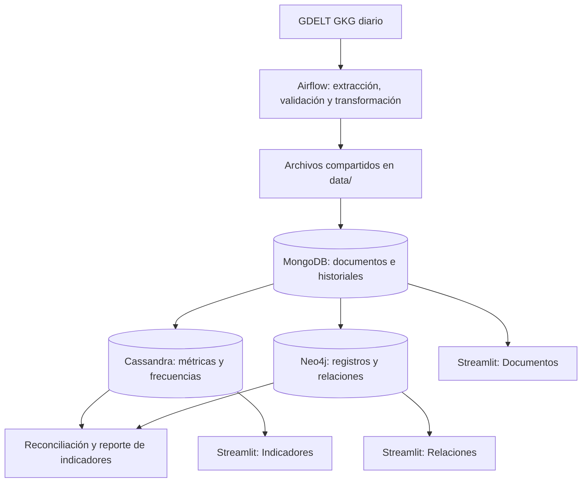

# 🌍 Global News Intelligence

Plataforma académica de análisis de registros GDELT GKG mediante MongoDB, Cassandra, Neo4j, Apache Airflow y Streamlit.

**Entrega totalmente local**, con Airflow y las tres bases en Docker, archivos en `data/` y Streamlit en el Mac. La configuración activa está en [`deploy/local.json`](deploy/local.json).

## Estado comprobado

- DAG de ocho tareas importado y ejecutado dos veces en Airflow 2.11.1 local: todas las tareas en `success`, sin duplicados al repetir.
- 84.723 registros del **27 de octubre de 2026** reconciliados en las tres bases del stack actual.
- Dashboard con tres vistas conectadas: indicadores Cassandra, documentos MongoDB y relaciones Neo4j.
- CRUD ejecutado y verificado en las tres bases con UUID propios y limpieza de datos de prueba.
- 28 pruebas automatizadas aprobadas y comprobación de la aplicación con bases reales, sin errores.
- Capturas reales del navegador e informe LaTeX/PDF actualizados.
- **Pendiente:** activar y observar una ejecución programada del scheduler, ampliar histórico coherente, revisar rendimiento y completar video/entrega.

Los cinco JSONL locales de 20261023–20261027 suman **323.202 registros**. Ese volumen de archivos no es el conteo de las bases actuales, que contienen la partición verificada de 84.723 registros. Un registro GKG no equivale a un artículo único.

## Arquitectura local



MongoDB conserva arrays y campos semiestructurados. Cassandra materializa consultas por fecha. Neo4j conecta registros con temas y organizaciones. Airflow y las tres bases están en Docker; Streamlit y los scripts también pueden ejecutarse en el venv del Mac. Los artefactos del DAG usan `file:///opt/gni/data`, montado desde `./data`.

## Arranque

Entorno comprobado: Python 3.14.6 en macOS; Airflow 2.11.1 con Python 3.12 dentro de Docker; MongoDB 8.0, Cassandra 5.0 y Neo4j 5.26 Community.

```bash
python3 -m venv .venv
source .venv/bin/activate
python -m pip install -r requirements-lock.txt
cp -n .env.example .env
```

Conservar el `.env` y el venv existentes. Editar la contraseña Neo4j en `.env` y exportar la configuración antes de ejecutar scripts:

```bash
set -a
source .env
set +a
docker compose up -d --wait --wait-timeout 600
python -m scripts.bootstrap_databases
```

Iniciar Airflow:

```bash
python -m scripts.prepare_airflow
docker compose --env-file .env --env-file .airflow/local.env \
  -f compose.yaml -f compose.airflow.yaml build airflow
docker compose --env-file .env --env-file .airflow/local.env \
  -f compose.yaml -f compose.airflow.yaml up -d --wait --wait-timeout 600 airflow
```

Iniciar el dashboard desde la raíz, con las variables exportadas:

```bash
python -m streamlit run dashboard/app.py
```

| Interfaz / servicio | Acceso desde el Mac |
|---|---|
| Streamlit | http://localhost:8501 |
| Airflow | http://localhost:8080 |
| Neo4j Browser | http://localhost:7475 |
| MongoDB | Puerto 27018 |
| Cassandra | Puerto 9043 |
| Neo4j Bolt | Puerto 7688 |

Airflow crea el usuario `admin` y una contraseña en su volumen, archivo `/opt/airflow/standalone_admin_password.txt`; no se versiona. `.airflow/local.env` contiene únicamente la clave generada de metadatos. No compartir esos archivos ni imprimir la configuración Compose completa en evidencias.

Guía detallada: [`docs/ejecucion_local.md`](docs/ejecucion_local.md).

## Pipeline y programación

`select_partition → extract → validate → transform → load_mongodb → [aggregate_cassandra, load_neo4j] → generate_indicators`

- Cron `0 6 * * *`: 06:00 UTC / 01:00 Lima. El equipo y Docker deben estar activos; GDELT requiere Internet para nuevas descargas.
- Fecha automática: día anterior al fin del intervalo UTC. Para pruebas manuales se usa `{"target_date":"20261027"}`.
- Dos reintentos separados por cinco minutos, máximo una ejecución activa y `catchup=False`.
- **DAG inicialmente pausado:** dos pruebas con `dag.test()` no equivalen a una ejecución cron observada.
- XCom transporta metadatos y rutas, no ZIP/JSONL. Las tareas recuperan sus archivos desde el volumen compartido y usan temporales locales.
- `pipeline_history` registra etapas y solo marca `completed` después de reconciliar las tres bases y publicar los seis indicadores.

Ejecutar las mismas etapas desde terminal:

```bash
python -m scripts.run_pipeline --date 20261027
```

La importación, ejecución histórica, repetición y programación del DAG se documentan en [`docs/airflow_local.md`](docs/airflow_local.md).

## Dashboard multimodelo

Las tres pestañas comparten una fecha. Las tarjetas de último día siguen mostrando la fecha más reciente de Cassandra; los rankings, documentos y grafo usan la selección.

| Vista | Base | Funcionalidad |
|---|---|---|
| Indicadores | Cassandra | Volumen, variación, top temas, diversidad, tono, top organizaciones y tabla diaria |
| Documentos | MongoDB | Tema exacto, búsqueda literal de organización, páginas de hasta 100 registros y documento JSON completo |
| Relaciones | Neo4j | Conteos por fecha, filtro exacto de entidad y grafo interactivo de hasta cinco registros |

Un fallo de una fuente no oculta las otras vistas. La caché de datos dura 60 segundos; **Actualizar datos** la invalida. Los textos de usuario se parametrizan en Cypher y la búsqueda organizacional MongoDB escapa caracteres de regex.

El grafo es una muestra acotada y no un ranking global. El cargador conserva solo las primeras diez entradas por lista de temas/organizaciones antes de deduplicar; esa limitación aparece en la vista.

## CRUD reproducible

```bash
python -m scripts.crud_demo --output docs/crud_verification.json
```

También admite `--database mongodb`, `--database cassandra` o `--database neo4j`. La demostración crea datos de prueba con UUID en `crud_demo` (MongoDB/Cassandra) o `CrudDemo` (Neo4j), lee el valor inicial, lo actualiza de 1 a 2, elimina y verifica la limpieza. Neo4j incluye creación, modificación y eliminación de una relación. Las tablas/colecciones vacías se conservan; no se borran registros GKG ni métricas.

## KPIs y resultados

| KPI | Definición |
|---|---|
| Volumen | Registros GKG por día y suma del período disponible |
| Variación | `100 × (R_actual − R_anterior_disponible) / R_anterior_disponible`; N/D sin base positiva |
| Top 10 temas | Registros que contienen cada tema; una contribución por registro y tema |
| Diversidad | Códigos temáticos distintos por fecha |
| Tono | Promedio del primer componente numérico de `tone_raw` |
| Top 10 organizaciones | Registros que contienen cada organización; deduplicación por registro |

Para 20261027 se comprobaron 84.723 registros, 8.817 temas distintos, 66.254 organizaciones distintas y tono medio −0,6621133004352675. Neo4j conserva 707.104 relaciones HAS_THEME y 239.232 MENTIONS_ORG. Con una sola fecha cargada, la variación es N/D y las líneas muestran un único punto.

## Pruebas y evidencias

```bash
python -m unittest discover -s tests -v
python -m scripts.verify_dashboard --date 20261027
python -m scripts.verify_partition --date 20261027 --output docs/verificacion_local.json
```

La suite usa datos sintéticos y clientes simulados; los dos últimos comandos necesitan bases reales. Las comprobaciones reales se ejecutaron y están guardadas:

- [`docs/airflow_verification_first.json`](docs/airflow_verification_first.json) y [`docs/airflow_verification_repeat.json`](docs/airflow_verification_repeat.json).
- [`docs/dashboard_verification.json`](docs/dashboard_verification.json).
- [`docs/crud_verification.json`](docs/crud_verification.json).
- [`docs/verificacion_local.json`](docs/verificacion_local.json).
- [`docs/local_environment_verification.json`](docs/local_environment_verification.json).
- Capturas reales y comprobación del navegador en [`docs/capturas/`](docs/capturas/).
- Informe: `informe.tex` y `informe.pdf`.

## Modelos y código

| Componente | Código / esquema |
|---|---|
| Configuración | `src/config.py`, `.env.example`, `deploy/local.json` |
| Ingesta y transformación | `src/ingestion/`, `src/transformation/`, `src/validation/` |
| Etapas del DAG y archivos | `src/pipeline/`, `dags/global_news_ingestion.py` |
| MongoDB | `scripts/mongodb/schema.json`; índices y creación en `scripts/bootstrap_databases.py` |
| Cassandra | `scripts/cassandra/schema.cql`; particiones por fecha y agrupación global |
| Neo4j | `scripts/neo4j/schema.cypher`; unicidad de nodos e índice de fecha |
| Dashboard | `dashboard/app.py`, `dashboard/queries.py`, `dashboard/graph.py` |
| CRUD | `scripts/crud_demo.py` |

## Limitaciones y cierre

Quedan la ejecución programada observada, la ampliación coherente del histórico en las tres bases, pruebas de recuperación/rendimiento y el video de 20–25 minutos con todos los integrantes. La entrega del curso es el **17 de noviembre de 2026**.

El reemplazo de agregados de entidades en Cassandra usa DELETE + INSERT y puede presentar lecturas parciales. Los rankings se ordenan en Python. Los identificadores documentales dependen de archivo y fila; el contrato asume archivos diarios inmutables. El grafo está truncado y los conteos no prueban la identidad de cada arista. La reproducción en una segunda máquina sigue pendiente.

Plan actualizado: [`docs/plan_proximos_pasos.md`](docs/plan_proximos_pasos.md).

Fuente de datos: [GDELT GKG](https://data.gdeltproject.org/gkg/index.html). Requisitos académicos: `instrucciones_proyecto.md`.
