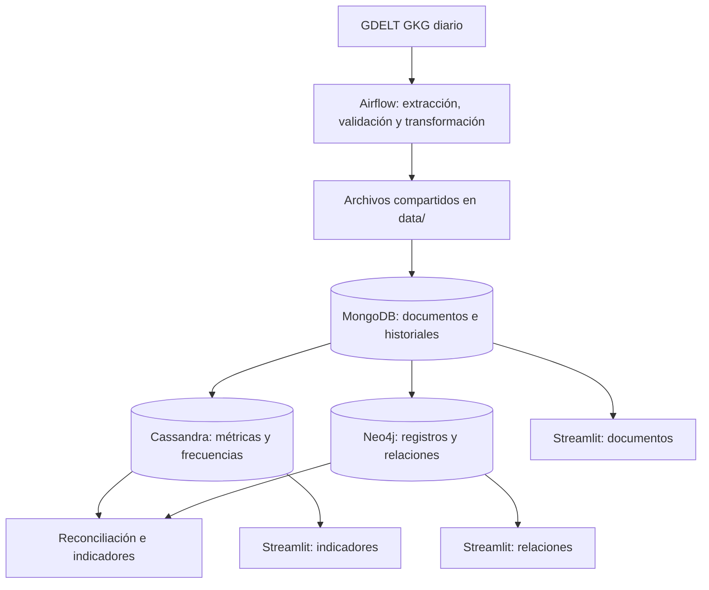
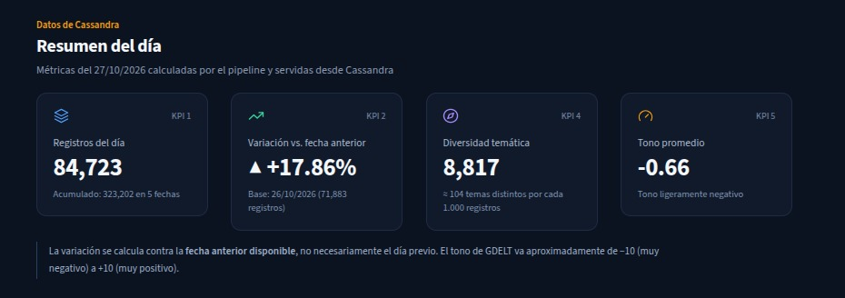

# 🌍 Global News Intelligence

Plataforma local para analizar registros GDELT GKG con MongoDB, Cassandra, Neo4j, Apache Airflow y Streamlit. Un único `compose.yaml` orquesta los servicios; los archivos del pipeline quedan en `data/`.

## Puesta en marcha local

Requisitos: Git y Docker Desktop instalado y en ejecución. Estos pasos son para Windows PowerShell y se ejecutan desde la carpeta del repositorio clonado.

1. Crea la configuración local a partir de la plantilla, si aún no existe:

   ```powershell
   if (!(Test-Path .env)) { Copy-Item .env.example .env }
   ```

2. Abre `.env` y configura la contraseña de acceso web de Airflow. `AIRFLOW_ADMIN_USERNAME` define el usuario (por defecto, `admin`) y `AIRFLOW_ADMIN_PASSWORD` su contraseña.

   ```powershell
   notepad .env
   ```

3. Construye y levanta la plataforma:

   ```powershell
   docker compose up -d --build --wait --wait-timeout 600
   ```

   Compose inicia las bases de datos, ejecuta `python -m scripts.bootstrap_databases` desde el contenedor Airflow y después arranca Airflow. El bootstrap es repetible y no elimina registros. El DAG queda activo desde su creación; con Docker encendido, programa una extracción diaria a las 06:00 UTC (01:00 en Lima). `catchup=False` evita recuperar todas las fechas históricas. La fecha programada se calcula como el día anterior al fin del intervalo UTC.

Al terminar, abre:

| Interfaz | Dirección |
|---|---|
| Dashboard Streamlit | <http://localhost:8501> |
| Airflow | <http://localhost:8080> |
| Neo4j Browser | <http://localhost:7475> |

Las bases se publican localmente en MongoDB `27018`, Cassandra `9043` y Neo4j Bolt `7688`. La autenticación interna de PostgreSQL y Neo4j está desactivada para este stack local; solo el usuario web de Airflow usa las credenciales de `.env`. No compartas ese archivo.

## Arquitectura



MongoDB conserva documentos con campos semiestructurados. Cassandra materializa métricas y frecuencias por fecha. Neo4j modela registros, temas y organizaciones como nodos conectados. Los artefactos del DAG usan `file:///opt/gni/data`, montado desde `./data`.

## Esquema de cada registro GKG

El transformador convierte cada fila del archivo GDELT GKG en un documento JSON. MongoDB valida los campos requeridos y sus tipos con [`scripts/mongodb/schema.json`](scripts/mongodb/schema.json).

| Campo | Tipo | Contenido |
|---|---|---|
| `_id` | Cadena | Hash SHA-256 del nombre del archivo y número de fila de origen |
| `date` | Cadena `YYYYMMDD` | Fecha extraída de `DATE` |
| `num_articles` | Entero | Valor de `NUMARTS` |
| `themes` | Lista de cadenas | Temas de `THEMES`, separados por punto y coma |
| `persons` | Lista de cadenas | Personas de `PERSONS` |
| `organizations` | Lista de cadenas | Organizaciones de `ORGANIZATIONS` |
| `sources` | Lista de cadenas | Fuentes de `SOURCES` |
| `source_urls` | Lista de cadenas | URLs de `SOURCEURLS` |
| `locations_raw` | Cadena | Valor original de `LOCATIONS` |
| `tone_raw` | Cadena | Valor original de `TONE` |
| `counts_raw` | Cadena | Valor original de `COUNTS` |
| `cameo_event_ids_raw` | Cadena | Valor original de `CAMEOEVENTIDS` |
| `source_file` | Cadena | Nombre del ZIP GKG de origen |

Las listas se separan por `;` y se eliminan elementos vacíos. Los campos terminados en `_raw` conservan el valor de GDELT sin descomponerlo. Cada documento representa un registro GKG, que puede agrupar referencias a varios artículos; no equivale necesariamente a un artículo individual.

## Pipeline y programación

`select_partition → extract → validate → transform → load_mongodb → [aggregate_cassandra, load_neo4j] → generate_indicators`

- El cron es `0 6 * * *` (06:00 UTC / 01:00 Lima). El equipo debe permanecer encendido y GDELT requiere Internet para descargar particiones nuevas.
- La fecha automática es el día anterior al fin del intervalo UTC. Para una ejecución manual se pasa, por ejemplo, `{"target_date":"20261027"}` en la configuración del DAG.
- Cada tarea admite dos reintentos separados por cinco minutos; se permite una ejecución activa y `catchup=False`.
- XCom transporta metadatos y rutas; los archivos ZIP y JSONL se comparten mediante `data/`.
- `pipeline_history` registra las etapas y solo marca una ejecución `completed` tras reconciliar las bases y publicar el informe de indicadores.

Para ejecutar una fecha manualmente desde un entorno Python local, con las bases de Compose ya levantadas y las dependencias instaladas:

```bash
python -m scripts.run_pipeline --date 20261027
```

## Dashboard

El dashboard tiene cuatro vistas que comparten la fecha seleccionada: Panorama, Indicadores, Documentos y Relaciones.

| Vista | Fuente | Funcionalidad |
|---|---|---|
| Panorama | Cassandra, MongoDB y Neo4j | Disponibilidad de las fuentes y resumen del día |
| Indicadores | Cassandra | Volumen, variación, temas, diversidad, tono y organizaciones |
| Documentos | MongoDB | Filtro por código de tema exacto, búsqueda literal de organización y páginas de 20, 50 o 100 documentos |
| Relaciones | Neo4j | Conteos, perfiles de entidades y muestra interactiva de hasta cinco registros |

Las vistas consultan sus fuentes de forma independiente, así un error de una base no oculta las demás. La mayoría de resultados se conserva en caché por 60 segundos; algunos análisis del grafo, por hasta cinco minutos. **Actualizar datos** limpia la caché. La búsqueda organizacional no distingue mayúsculas y escapa los caracteres especiales.

La muestra de grafo no es un ranking global. Al cargar Neo4j se conservan como máximo las primeras diez entradas de cada lista de temas y organizaciones por registro, antes de deduplicar.



## KPI e indicadores relacionales

El proyecto define seis KPI de negocio, calculados desde MongoDB y servidos desde Cassandra, y cinco indicadores relacionales formales sobre el grafo Neo4j. El dashboard presenta también el total de entidades únicas como **R0**, un conteo descriptivo adicional que no forma parte de los cinco indicadores relacionales numerados en el informe.

### KPI de negocio (Cassandra)

| KPI | Definición |
|---|---|
| 1. Volumen diario | Registros GKG en una fecha; también se muestra el total de las fechas disponibles |
| 2. Variación diaria | `100 × (registros actuales − registros de la fecha anterior disponible) / registros de la fecha anterior disponible`; N/D si no existe una base positiva |
| 3. Frecuencia de temas | Registros que contienen cada tema; una contribución por registro y tema; se muestran los diez primeros |
| 4. Diversidad temática | Número de códigos temáticos distintos por fecha |
| 5. Tono promedio | Promedio del primer componente numérico de `tone_raw`, usando registros con tono válido |
| 6. Organizaciones más mencionadas | Registros que contienen cada organización, deduplicada por registro; se muestran las diez primeras |

### Indicadores relacionales (Neo4j)

| Indicador | Definición que muestra el dashboard |
|---|---|
| R0. Entidades únicas | Total de temas distintos más organizaciones distintas para la fecha; conteo descriptivo adicional |
| R1. Concentración del Top 10 | Porcentaje de todas las menciones que corresponde a las diez entidades más mencionadas, calculado por separado para temas y organizaciones |
| R2. Cola larga | Porcentaje de entidades que aparecen en exactamente un registro, calculado por separado para temas y organizaciones |
| R3. Conectividad por registro | Relaciones `HAS_THEME` y `MENTIONS_ORG` divididas entre el número de registros de la fecha |
| R4. Co-ocurrencia de organizaciones | Registros compartidos por pares entre las 40 organizaciones más mencionadas; se muestran hasta diez pares |
| R5. Afinidad de una entidad | Para una organización o tema seleccionado, porcentaje de sus registros que también contiene cada entidad relacionada; se muestran hasta diez relaciones |

R1–R5 corresponden a los cinco indicadores relacionales definidos en el [informe](docs/informe/main.tex). R0 aparece en el dashboard como contexto del grafo. R1 y R2 se presentan para temas y organizaciones; el grafo solo conserva hasta diez entradas de cada lista por registro, por lo que sus resultados reflejan ese límite.

Como referencia histórica, la partición del **27 de octubre de 2026** fue verificada con 84.723 registros, 8.817 temas y 66.254 organizaciones distintas, con tono medio −0,6621. El informe de verificación también registró 707.104 relaciones `HAS_THEME` y 239.232 `MENTIONS_ORG`, sujetas al límite de entidades por registro.

Los informes guardados en `docs/data-utils/` son evidencias de ejecuciones fechadas; no indican por sí solos qué datos hay ahora en los volúmenes locales. Por ejemplo, el snapshot verificado el 8 de noviembre de 2026 contiene seis fechas y 403.941 registros en total. No hay datos de GDELT incluidos en un clon nuevo: el DAG descarga la partición que le corresponde al ejecutarse.

## Verificación

Para ejecutar las pruebas unitarias:

```bash
python -m unittest discover -s tests -v
```

Las comprobaciones de integración consultan bases reales. Algunos ejemplos para una fecha ya cargada:

```bash
python -m scripts.verify_dashboard --date 20261027
python -m scripts.verify_partition --date 20261027
```

Evidencias versionadas: [verificación histórica](docs/data-utils/historical_verification.json), [ejecución programada de Airflow](docs/data-utils/airflow_scheduled_verification.json), [verificación del dashboard](docs/data-utils/dashboard_verification.json), [recuperación de Cassandra](docs/data-utils/cassandra_recovery_verification.json), [CRUD](docs/data-utils/crud_verification.json) y [capturas](docs/capturas/).

## Código y esquemas

| Componente | Ubicación |
|---|---|
| Configuración | `src/config.py`, `.env.example`, `deploy/local.json` |
| Ingesta, validación y transformación | `src/ingestion/`, `src/validation/`, `src/transformation/` |
| DAG y etapas | `dags/global_news_ingestion.py`, `src/pipeline/` |
| Bootstrap | `scripts/bootstrap_databases.py` |
| Esquema MongoDB | `scripts/mongodb/schema.json` |
| Esquema Cassandra | `scripts/cassandra/schema.cql` |
| Esquema Neo4j | `scripts/neo4j/schema.cypher` |
| Dashboard | `dashboard/app.py`, `dashboard/queries.py`, `dashboard/graph.py` |
| Imágenes de bases de datos | `docker/mongo/`, `docker/cassandra/`, `docker/neo4j/` |

Fuente: [GDELT GKG](https://data.gdeltproject.org/gkg/index.html). El informe del proyecto está en [`docs/informe/main.tex`](docs/informe/main.tex).
