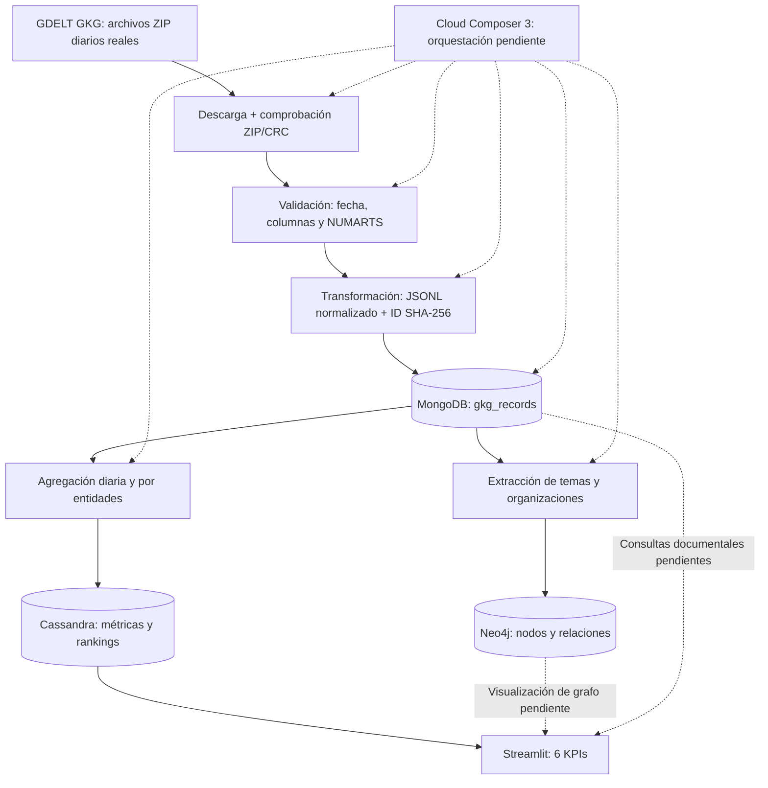
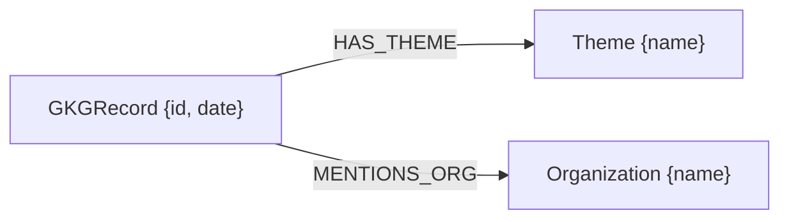
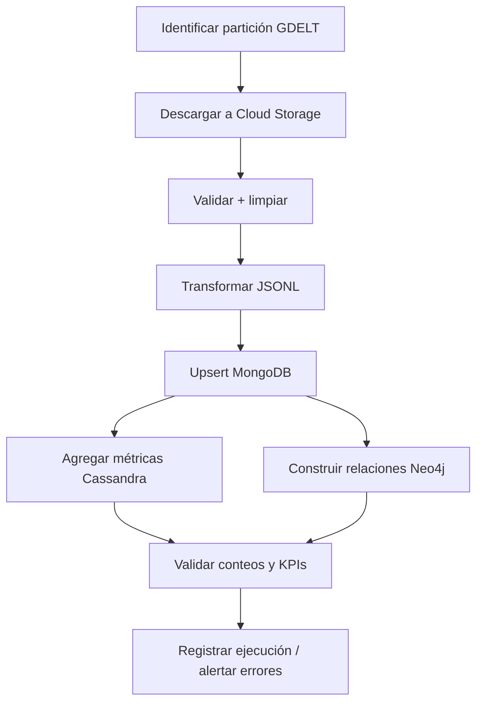

# 🌍 Global News Intelligence

**Plataforma de inteligencia de noticias globales basada en GDELT, bases de datos multimodelo y analítica temporal.**

> **Estado del proyecto:** ingesta histórica e incremental local operativas; MongoDB, Cassandra y Neo4j con datos reales; dashboard Streamlit con seis KPIs implementados. La integración completa con Apache Airflow / Google Cloud Composer 3, la conectividad nube–bases locales, las pruebas CRUD y los entregables finales siguen pendientes.
>
> **Corte de datos verificado:** 23–27 de octubre de 2026. **Última revisión documental:** 29 de octubre de 2026. Las cifras de este README son una fotografía del estado comprobado, no un contador en vivo.

## Contenido

1. [Propósito y requisitos](#1-propósito-y-requisitos)
2. [Arquitectura del sistema](#2-arquitectura-del-sistema)
3. [Tecnologías y configuración](#3-tecnologías-y-configuración)
4. [Fuente de datos y modelo GKG](#4-fuente-de-datos-y-modelo-gkg)
5. [Estructura del repositorio](#5-estructura-del-repositorio)
6. [Pipeline de ingesta](#6-pipeline-de-ingesta)
7. [MongoDB: almacenamiento documental](#7-mongodb-almacenamiento-documental)
8. [Cassandra: analítica temporal](#8-cassandra-analítica-temporal)
9. [Neo4j: grafo de conocimiento](#9-neo4j-grafo-de-conocimiento)
10. [Dashboard y definición de KPIs](#10-dashboard-y-definición-de-kpis)
11. [Airflow y Cloud Composer 3](#11-airflow-y-cloud-composer-3)
12. [Ejecución local y verificación](#12-ejecución-local-y-verificación)
13. [Resultados comprobados](#13-resultados-comprobados)
14. [Decisiones técnicas y limitaciones](#14-decisiones-técnicas-y-limitaciones)
15. [Pendientes y plan de trabajo](#15-pendientes-y-plan-de-trabajo)
16. [Entregables académicos](#16-entregables-académicos)
17. [Fuentes y notas de reproducibilidad](#17-fuentes-y-notas-de-reproducibilidad)

---

## 1. Propósito y requisitos

Global News Intelligence es un proyecto académico de **Big Data** que transforma registros públicos de noticias globales en indicadores temporales, rankings de entidades y relaciones consultables. Busca responder preguntas como: ¿cómo cambia el volumen de registros de un día a otro?, ¿qué temas y organizaciones aparecen con más frecuencia?, ¿qué diversidad temática se observa?, ¿cómo evoluciona el tono informativo?, ¿qué conexiones existen entre registros, temas y organizaciones?

La fuente seleccionada es **GDELT Global Knowledge Graph (GKG)**, con archivos diarios reales e históricos. No se simulan actualizaciones: se descargan nuevas particiones disponibles de GDELT.

### Requisitos del curso y avance

| Requisito | Situación | Evidencia / brecha |
|---|---|---|
| ≥50 000 registros semiestructurados | ✅ Cumplido | 323 202 registros GKG procesados en MongoDB |
| Fuente actualizable periódicamente | ✅ Capacidad implementada | Descarga por fecha e ingesta incremental; programación automática pendiente |
| MongoDB documental | ✅ Implementado | `gkg_records` e historiales de ingesta |
| Cassandra para agregados y series temporales | ✅ Implementado | Tres tablas de métricas por día |
| Neo4j para relaciones | 🟡 Parcial | Grafo de 2026-10-27 cargado; cobertura histórica e integración faltantes |
| DAG Airflow de extremo a extremo y programado | ⏳ Pendiente | Cloud Composer 3 disponible; primer DAG de validación propuesto, no confirmado como desplegado |
| CRUD demostrable en las tres bases | ⏳ Pendiente | Las cargas realizan operaciones, pero faltan scripts y demostraciones CRUD completas |
| Dashboard conectado a las tres bases | 🟡 Parcial | Seis KPIs desde Cassandra; falta incorporar consulta visual a MongoDB y Neo4j |
| ≥5 KPIs con definición, fórmula e interpretación | ✅ Implementados en dashboard; documentación incluida aquí | Seis KPIs |
| Informe, código, video y evidencias | ⏳ Pendiente | Ver sección 16 |

**Fecha de entrega del curso:** 17 de noviembre de 2026, según el documento de instrucciones proporcionado.

## 2. Arquitectura del sistema

### 2.1 Arquitectura lógica



### 2.2 Despliegue actual y objetivo

**Actual:** Python y Streamlit en macOS; MongoDB, Cassandra y Neo4j en contenedores Docker locales; los procesos de ingesta y agregación se ejecutan desde la terminal. **Cloud Composer 3 existe en GCP**, pero todavía no está integrado ni verificado para ejecutar el pipeline completo. La región del entorno aún no está identificada.

**Objetivo:** Composer programa y supervisa tareas; Cloud Storage conserva archivos crudos/procesados y permite intercambio entre trabajadores; los servicios de procesamiento acceden a bases de datos mediante conectividad segura; Streamlit consulta las tres bases. **No se ha implementado ni verificado esta arquitectura cloud completa.**

> **Restricción clave:** `127.0.0.1`/`localhost` dentro de Cloud Composer **no apunta al Mac**. No exponer MongoDB, Cassandra ni Neo4j a Internet sin autenticación, cifrado y controles de red. Para producción se deberá elegir una solución de conectividad privada o trasladar los servicios a infraestructura accesible desde GCP.

## 3. Tecnologías y configuración

| Capa | Tecnología | Estado / detalle |
|---|---|---|
| Fuente | GDELT GKG, formato diario legado | Archivos `YYYYMMDD.gkg.csv.zip` |
| Lenguaje | Python | Scripts de ingesta, agregación y dashboard |
| Entorno local | macOS, terminal VS Code, `venv` | Configuración del usuario; versión Python exacta del entorno del proyecto por confirmar |
| Contenedores | Docker Desktop | Bases locales |
| Documental | MongoDB 8 | Contenedor `gni-mongodb`, host `27018` |
| Analítica | Cassandra 5.0 | Contenedor `gni-cassandra`, host `9043` |
| Grafo | Neo4j 5 | Contenedor `gni-neo4j`, HTTP `7475`, Bolt `7688` |
| Dashboard | Streamlit 1.66.1, pandas, Plotly | `dashboard/app.py`, host `8501` |
| Cliente Cassandra | `cassandra-driver` | Conexión desde Python |
| Orquestación | Apache Airflow en Cloud Composer 3 | Entorno existente; DAG pendiente de desplegar/verificar |
| Almacenamiento cloud | Google Cloud Storage | Propuesto; bucket/ruta aún no identificados |

### Conexiones locales

| Sistema | Dirección desde el Mac | Nombre lógico |
|---|---|---|
| MongoDB | `mongodb://127.0.0.1:27018` | Base `global_news` |
| Cassandra | `127.0.0.1:9043` | Keyspace `global_news_analytics` |
| Neo4j | `bolt://127.0.0.1:7688` | Credenciales mediante variables de entorno |
| Neo4j Browser | `http://localhost:7475` | Interfaz de exploración |
| Streamlit | `http://localhost:8501` | Dashboard local |

**Seguridad:** nunca versionar contraseñas, claves de servicio ni archivos `.env`. La variable `NEO4J_PASSWORD` se ha usado en el entorno local; los nombres de otras variables y archivos de configuración deben confirmarse contra el código real. Los puertos indicados son los del **host**, no necesariamente los puertos internos de cada contenedor.

## 4. Fuente de datos y modelo GKG

- **Fuente:** [GDELT GKG](https://data.gdeltproject.org/gkg/index.html).
- **Formato utilizado:** archivo ZIP diario que contiene un CSV/TSV sin encabezado con **11 campos**, separados por tabuladores.
- **Particiones:** fechas en formato `YYYYMMDD`, por ejemplo `20261027.gkg.csv.zip`.
- **Naturaleza:** registros semiestructurados que describen información extraída/agregada de cobertura informativa; incluyen temas, personas, organizaciones, ubicaciones, tono y fuentes.
- **Histórico + actualizaciones:** los archivos antiguos pueden recuperarse por fecha y se pueden consultar archivos nuevos cuando GDELT los publica.

### Campos GKG originales

| Campo | Descripción |
|---|---|
| `DATE` | Marca temporal del registro |
| `NUMARTS` | Cantidad de artículos asociados en el campo de GKG; **no** identifica artículos únicos |
| `COUNTS` | Conteos codificados por GDELT |
| `THEMES` | Temas/códigos separados por delimitadores |
| `LOCATIONS` | Ubicaciones codificadas |
| `PERSONS` | Personas extraídas |
| `ORGANIZATIONS` | Organizaciones o entidades nombradas |
| `TONE` | Métricas de tono; se utiliza el primer valor numérico disponible |
| `CAMEOEVENTIDS` | Identificadores de eventos CAMEO |
| `SOURCES` | Fuentes asociadas |
| `SOURCEURLS` | URL de fuentes asociadas |

**Interpretación esencial:** un **registro GKG no equivale a una noticia/artículo único**. Por eso los KPIs hablan de *registros GKG*, *menciones en registros* y *códigos temáticos*, no de noticias únicas. Los nombres del campo `ORGANIZATIONS` pueden incluir instituciones, países o entidades genéricas; no deben interpretarse automáticamente como empresas.

### Ejemplo esquemático del documento transformado

```json
{
  "_id": "<sha256_determinista>",
  "date": "20261027",
  "num_articles": 1,
  "themes": ["TAX_FNCACT", "EPU_POLICY"],
  "persons": [],
  "organizations": ["google"],
  "sources": [],
  "source_urls": [],
  "locations_raw": "<campo_GDELT_original>",
  "tone_raw": "-0.5,..."
}
```

**Ejemplo ilustrativo, no documento extraído literalmente de la base.** El esquema completo y los tipos deben validarse contra una muestra real de `data/processed/*.jsonl` antes de fijar un contrato formal.

## 5. Estructura del repositorio

Rutas **conocidas por el trabajo realizado** (árbol parcial, no inventario exhaustivo):

```text
global-news-intelligence/
├── dashboard/
│   └── app.py
├── data/
│   ├── raw/                         # ZIP diarios descargados
│   └── processed/                   # YYYYMMDD.jsonl
├── src/
│   ├── ingestion/
│   │   ├── check_gdelt_index.py
│   │   ├── download_gdelt.py
│   │   ├── load_mongodb.py
│   │   ├── load_neo4j.py
│   │   └── run_incremental.py
│   ├── transformation/
│   │   ├── transform_gkg.py
│   │   ├── aggregate_daily.py
│   │   └── aggregate_entities.py
│   └── validation/
│       └── validate_gkg.py
├── scripts/
│   └── cassandra/
│       └── check_kpis.py
├── dags/                              # Prevista para Composer 3
│   └── global_news_ingestion.py       # Propuesto, no confirmado en repo
└── README.md                          # Documento a incorporar
```

**Nota:** no se ha inspeccionado el árbol Git actual ni el contenido de cada script en esta sesión. No se atribuyen rutas de `docker-compose.yml`, DDL, tests o dependencias que no hayan sido confirmadas. Al incorporar este README, actualizar el árbol mediante `find . -maxdepth 4 -type f` o `tree`.

## 6. Pipeline de ingesta

### 6.1 Descubrimiento y descarga

- `src/ingestion/check_gdelt_index.py`: revisa el índice de archivos disponibles.
- `src/ingestion/download_gdelt.py`: descarga ZIP por fecha; verifica CRC; utiliza archivo temporal `.part` y renombrado atómico; evita repetir descargas existentes.
- Los archivos originales se conservan bajo `data/raw/`.

### 6.2 Validación

- `src/validation/validate_gkg.py`: comprueba estructura de fila, fecha y `NUMARTS`.
- Las verificaciones impiden que archivos inválidos entren silenciosamente al flujo de transformación.
- **Pendiente:** suite automatizada de casos inválidos, política explícita de filas descartadas y evidencia formal de cobertura.

### 6.3 Transformación

- `src/transformation/transform_gkg.py`: convierte cada fila a JSONL en `data/processed/YYYYMMDD.jsonl`.
- Normaliza campos de listas como `themes`, `persons`, `organizations`, `sources` y `source_urls`.
- Conserva campos crudos necesarios para análisis posterior (`locations_raw`, `tone_raw`).
- Genera `_id` determinista basado en SHA-256 para favorecer cargas repetibles.

### 6.4 Ingesta incremental

- `src/ingestion/run_incremental.py --days N`: consulta el historial de ingesta; ejecuta descarga → validación → transformación → MongoDB para las fechas pendientes; comprueba conteos.
- El historial se guarda en MongoDB, colección `ingestion_history`.
- Las cargas a MongoDB usan **upsert** por identificador estable, para evitar duplicados al reejecutar.
- **Límite actual:** la ingesta incremental hacia MongoDB no implica que Cassandra y Neo4j se actualicen automáticamente en la misma ejecución. Falta orquestación end-to-end.

## 7. MongoDB: almacenamiento documental

**Contenedor:** `gni-mongodb` (`mongo:8`). **Puerto host:** `27018`. **Base:** `global_news`.

### Colecciones

| Colección | Función |
|---|---|
| `gkg_records` | Documentos normalizados de GDELT |
| `ingestion_history` | Estado y trazabilidad de cargas por fecha |
| `neo4j_ingestion_history` | Control de fechas cargadas al grafo |

### Modelo documental

Cada documento de `gkg_records` representa un registro GKG y contiene un `_id` determinista, fecha, campos de entidades, fuentes y campos originales seleccionados. Las listas permiten consultas documentales sin normalizar cada tema u organización en tablas relacionales.

**Diseño de idempotencia:** la clave `_id` estable permite reintentar sin insertar una segunda copia del mismo registro; el historial permite omitir fechas completadas. Se deben comprobar índices, políticas de actualización y recuperación tras fallos parciales en la versión final.

**Volumen comprobado:** **323 202** documentos GKG para cinco días, desglosados en la sección 13.

## 8. Cassandra: analítica temporal

**Contenedor:** `gni-cassandra` (`cassandra:5.0`). **Puerto host:** `9043`. **Keyspace:** `global_news_analytics`.

### 8.1 Métricas globales por fecha

```sql
CREATE TABLE daily_news_metrics (
    metric_group TEXT,
    news_date DATE,
    total_records BIGINT,
    unique_themes INT,
    average_tone DOUBLE,
    PRIMARY KEY (metric_group, news_date)
) WITH CLUSTERING ORDER BY (news_date DESC);
```

`metric_group = 'global'` agrupa las fechas bajo una misma partición lógica. La clave de clustering descendente favorece lectura cronológica reciente.

### 8.2 Temas por día

```sql
CREATE TABLE daily_theme_metrics (
    news_date DATE,
    theme TEXT,
    record_count BIGINT,
    PRIMARY KEY (news_date, theme)
);
```

### 8.3 Organizaciones por día

```sql
CREATE TABLE daily_organization_metrics (
    news_date DATE,
    organization TEXT,
    record_count BIGINT,
    PRIMARY KEY (news_date, organization)
);
```

### Cálculo de agregados

- `src/transformation/aggregate_daily.py`: lee registros desde MongoDB y calcula volumen, cantidad de temas distintos y promedio del primer valor numérico de `tone_raw`.
- `src/transformation/aggregate_entities.py`: cuenta **registros que contienen** cada tema/organización; deduplica repeticiones dentro del mismo documento. Para actualizar una fecha, elimina la partición y vuelve a insertarla.
- `scripts/cassandra/check_kpis.py`: consulta las tablas y muestra rankings.

**Advertencias de rendimiento/consistencia:** Cassandra ordena las filas por clave de clustering, **no** por `record_count`. Hoy Streamlit lee las entidades de una fecha, ordena en Python y toma el Top 10. En 2026-10-27 la tabla de organizaciones contenía **66 254 filas**; conviene precalcular rankings. El patrón *DELETE + INSERT* de una partición no es una sustitución atómica: durante un fallo o actualización, puede existir una ventana de datos incompletos.

## 9. Neo4j: grafo de conocimiento

**Contenedor:** `gni-neo4j` (`neo4j:5`). **HTTP host:** `7475`. **Bolt host:** `7688`.

### Modelo



**Nodos:** `GKGRecord`, `Theme`, `Organization`. **Relaciones:** `HAS_THEME`, `MENTIONS_ORG`. Se han definido restricciones de unicidad para `GKGRecord.id`, `Theme.name` y `Organization.name`.

`src/ingestion/load_neo4j.py` lee documentos desde MongoDB y utiliza operaciones `MERGE` por lotes de 100. Acepta fecha y un límite opcional para pruebas. En cargas completas registra el resultado en `neo4j_ingestion_history` y omite fechas ya completadas.

**Carga comprobada:** 84 723 nodos `GKGRecord` correspondientes al 27 de octubre de 2026, en **25,45 segundos**. El conteo se contrastó con MongoDB. El historial de carga quedó marcado como `completed`.

**Limitación explícita:** para cada documento, el cargador toma **solo los primeros 10 temas y las primeras 10 organizaciones**. Por tanto, las relaciones del grafo son un **subconjunto** de las entidades disponibles en MongoDB; no representan cobertura exhaustiva. La verificación de conteo de nodos no garantiza integridad de todas las relaciones.

**Pendiente:** cargar otras fechas, definir estrategia de reprocesamiento/actualización de relaciones, validar conteos de aristas, añadir consultas de centralidad/conectividad y visualizar el grafo en Streamlit.

## 10. Dashboard y definición de KPIs

**Aplicación:** `dashboard/app.py` con Streamlit, pandas y Plotly. **URL local:** `http://localhost:8501`. Diseño oscuro, tarjetas métricas, gráficos temporales, rankings horizontales y tabla desplegable.

Los seis KPIs se encuentran implementados y se han verificado visualmente en el dashboard. Los rankings se obtienen de Cassandra y utilizan la fecha más reciente; **un selector de fechas fue propuesto, pero su instalación y prueba no están confirmadas**.

| KPI | Definición y fórmula | Interpretación / fuente |
|---|---|---|
| **1. Volumen de registros** | `total = Σ total_records(d)` para los días cargados | Volumen de registros GKG procesados, **no artículos únicos**; Cassandra `daily_news_metrics` |
| **2. Variación diaria (%)** | `100 × (R_d − R_(d−1)) / R_(d−1)` | Crecimiento o descenso respecto al día previo **disponible**; requiere denominador > 0 |
| **3. Top 10 temas** | Para tema `t` y día `d`: `count(t,d) = # registros del día d que incluyen t`; ordenar y tomar 10 | Códigos temáticos más frecuentes; un registro puede aportar a varios temas |
| **4. Diversidad temática** | `|{t : t aparece en al menos un registro del día d}|` | Número de códigos temáticos distintos por día; no es un índice de diversidad normalizado |
| **5. Tono promedio** | `Σ tono(r) / N_con_tono`, usando el primer valor numérico de `tone_raw` | Tendencia media del indicador de tono GDELT; no equivale a sentimiento humano validado |
| **6. Top 10 entidades organizacionales** | `count(o,d) = # registros del día d que incluyen o`; ordenar y tomar 10 | Entidades del campo `ORGANIZATIONS` más frecuentes; no necesariamente empresas |

### Datos de referencia del dashboard

- Volumen total procesado: **323 202** registros.
- Último día disponible: **2026-10-27**, con **84 723** registros.
- Variación frente a 2026-10-26: aproximadamente **+17,86 %**.
- Diversidad temática del último día: **8 817** códigos.
- Tono promedio del último día: **−0,66** (valor redondeado; agregado exacto `−0,662113`).
- Entidad más frecuente del último día: `united states`, presente en **7 900** registros.

### Funciones conocidas de `dashboard/app.py`

- `get_cassandra_session()` con `@st.cache_resource`.
- `get_daily_metrics()`, `get_top_themes(target_date)` y `get_top_organizations(target_date)` con `@st.cache_data(ttl=300)`.
- Gráfico de volumen por fecha; ranking Top 10 de temas; líneas de diversidad y tono; ranking Top 10 de organizaciones; tabla de datos diarios.
- **Pendiente:** visualización Neo4j y consultas documentales MongoDB en el mismo dashboard; selección de fechas confirmada; actualización/refresh tras nuevas cargas; metadatos de calidad y cobertura.

## 11. Airflow y Cloud Composer 3

### Estado actual

El proyecto cuenta con un **entorno Cloud Composer 3 en GCP**. Su **región no está identificada** y no se ha confirmado todavía el despliegue ni una ejecución exitosa del DAG del proyecto.

Se ha diseñado un primer DAG llamado `global_news_ingestion`, propuesto en `dags/global_news_ingestion.py`, con dos tareas:

1. `check_availability`: comprueba la URL de un ZIP diario de GDELT, usando `dag_run.conf["target_date"]` o el día anterior en UTC.
2. `download_and_validate`: descarga el ZIP, verifica integridad CRC, localiza el CSV y valida columnas, fecha y `NUMARTS`.

**Estado de ese código:** proporcionado como propuesta en la conversación; **no se ha confirmado que el archivo exista en el repositorio, que importe correctamente en Composer o que haya ejecutado con éxito**. No se debe describir como un DAG productivo. La propuesta utiliza `schedule=None` para pruebas manuales, no programación diaria, y mantiene temporalmente el ZIP en memoria; ambos aspectos requieren revisión antes de producción.

### DAG final requerido



**Diseño recomendado:** conservar objetos crudos y procesados en GCS, evitar pasar archivos grandes por XCom, usar tareas idempotentes por fecha, establecer reintentos y controles de calidad, y separar la orquestación de los procesos intensivos cuando sea necesario. El DAG final debe ejecutarse en horario fijo con política de retraso de publicación GDELT, y no marcar una fecha como completada si fallan etapas posteriores.

### Prueba inicial propuesta

Ejecutar manualmente con:

```json
{"target_date": "20261027"}
```

**Antes de hacerlo:** verificar el patrón de URL GDELT contra el script local que ya descarga correctamente; validar compatibilidad de Airflow/Composer; identificar el bucket de DAGs; revisar permisos de salida a Internet. No se ha confirmado que `https://data.gdeltproject.org/gkg/20261027.gkg.csv.zip` sea el endpoint correcto del entorno; debe contrastarse con el índice GDELT y el descargador existente.

### Conectividad cloud pendiente

Composer no puede conectarse a los puertos `localhost:27018`, `9043` y `7688` del Mac. Alternativas a evaluar: bases desplegadas en red privada accesible desde GCP, túnel privado seguro hacia infraestructura local (apropiado solo si se garantiza disponibilidad), o desacoplar Composer de la carga local mediante almacenamiento/colas y un trabajador local controlado. La elección depende de costos, recursos del curso, conectividad y seguridad. **No hay decisión de despliegue tomada.**

## 12. Ejecución local y verificación

> Los comandos siguientes se basan en rutas y argumentos conocidos. Antes de ejecutarlos en otra máquina, confirmar dependencias, variables de entorno, imágenes y volúmenes contra los archivos reales del repositorio.

### 12.1 Activar el entorno

```bash
cd global-news-intelligence
source .venv/bin/activate
```

### 12.2 Comprobar contenedores

```bash
docker ps --filter name=gni-mongodb \
          --filter name=gni-cassandra \
          --filter name=gni-neo4j
```

Los tres contenedores deben estar activos. El comando solo inspecciona; no crea bases ni modifica datos.

### 12.3 Consultar archivos disponibles

```bash
python -m src.ingestion.check_gdelt_index
```

Si la invocación `-m` no coincide con la interfaz del script, consultar `--help` o ejecutarlo según el README original del código. No se ha validado aquí el CLI exacto de todos los módulos.

### 12.4 Ejecutar ingesta incremental hacia MongoDB

```bash
python -m src.ingestion.run_incremental --days 5
```

Este argumento `--days` está confirmado en el desarrollo. Su interpretación exacta (ventana de fechas y omisión de días completos) debe revisarse antes de automatizar.

### 12.5 Consultar KPIs

```bash
python scripts/cassandra/check_kpis.py
```

### 12.6 Iniciar dashboard

```bash
python -m streamlit run dashboard/app.py
```

Abrir `http://localhost:8501`. Las consultas de Cassandra están configuradas en la aplicación con `Cluster(["127.0.0.1"], port=9043)` y `cluster.connect("global_news_analytics")`.

### 12.7 Comprobaciones recomendadas

**MongoDB** (adaptar autenticación y comando de acceso si corresponde):

```javascript
use global_news
db.gkg_records.countDocuments({date: "20261027"})
db.ingestion_history.find().limit(5)
db.neo4j_ingestion_history.find({_id: "20261027"})
```

**Cassandra** (dentro de un cliente `cqlsh` conectado al keyspace):

```sql
SELECT * FROM global_news_analytics.daily_news_metrics
WHERE metric_group = 'global';

SELECT * FROM global_news_analytics.daily_theme_metrics
WHERE news_date = '2026-10-27';
```

**Neo4j** (en Neo4j Browser):

```cypher
MATCH (r:GKGRecord {date: '20261027'})
RETURN count(r) AS registros;

MATCH (r:GKGRecord {date: '20261027'})-[:HAS_THEME]->(t:Theme)
RETURN t.name AS tema, count(*) AS conexiones
ORDER BY conexiones DESC LIMIT 10;
```

## 13. Resultados comprobados

### 13.1 Volumen de registros

| Fecha | Registros GKG | Temas distintos | Tono promedio |
|---|---:|---:|---:|
| 2026-10-23 | 79 349 | 8 850 | −0,830658 |
| 2026-10-24 | 47 019 | 7 809 | −1,062080 |
| 2026-10-25 | 40 228 | 7 476 | −1,123210 |
| 2026-10-26 | 71 883 | 8 554 | −0,673649 |
| 2026-10-27 | 84 723 | 8 817 | −0,662113 |
| **Total** | **323 202** | **No sumable como total global** | **No promediar sin ponderar** |

Los temas distintos diarios no se suman para obtener temas globales únicos, porque un código puede aparecer en varios días. El promedio de tono multidiario requeriría ponderación por cantidad de registros con tono válido.

### 13.2 Temas más frecuentes — 2026-10-27

| Tema GDELT | Registros |
|---|---:|
| `TAX_FNCACT` | 69 748 |
| `EPU_POLICY` | 38 120 |
| `TAX_ETHNICITY` | 32 797 |
| `CRISISLEX_CRISISLEXREC` | 31 184 |
| `UNGP_FORESTS_RIVERS_OCEANS` | 28 849 |
| `WB_696_PUBLIC_SECTOR_MANAGEMENT` | 28 254 |
| `USPEC_POLITICS_GENERAL1` | 25 821 |
| `TAX_WORLDLANGUAGES` | 24 801 |
| `LEADER` | 24 115 |
| `CRISISLEX_C07_SAFETY` | 22 528 |

### 13.3 Entidades organizacionales más frecuentes — 2026-10-27

| Entidad | Registros |
|---|---:|
| `united states` | 7 900 |
| `instagram` | 2 830 |
| `associated press` | 2 487 |
| `supreme court` | 2 459 |
| `australian associated` | 2 128 |
| `white house` | 2 112 |
| `google` | 1 914 |
| `reuters` | 1 809 |
| `facebook` | 1 766 |
| `disney` | 1 630 |

### 13.4 Neo4j

- Partición cargada: **20261027**.
- Nodos `GKGRecord` para esa fecha: **84 723**.
- Duración reportada de la carga completa: **25,45 s**.
- Registro de historial: `status: completed`.
- No se ha comprobado todavía la integridad total de aristas ni la carga histórica de todas las fechas.

## 14. Decisiones técnicas y limitaciones

### Justificación multimodelo

- **MongoDB:** documentos heterogéneos, arrays de entidades y trazabilidad de la ingesta; es el repositorio principal para registros transformados.
- **Cassandra:** consultas por fecha y entidad con claves diseñadas para agregados; evita recalcular los seis KPIs leyendo todos los documentos en cada carga de dashboard.
- **Neo4j:** representa explícitamente relaciones entre registros y entidades, habilitando exploración de conexiones y análisis de grafo.
- **Airflow/Composer:** orquesta dependencias, reintentos, programación y observabilidad; **no** es la base de datos ni el motor que debe almacenar los ZIP.

### Limitaciones actuales

1. **No equivale a un censo de artículos:** GKG produce registros agregados, no un identificador único de cada noticia.
2. **Cinco días de datos:** suficientes para el umbral académico, pero pocos para tendencias robustas; extender histórico.
3. **Sesgo/cobertura GDELT:** disponibilidad de fuentes, idiomas y extracción automática pueden afectar rankings y tono.
4. **Tono:** indicador provisto por GDELT; evitar afirmaciones causales o interpretaciones como opinión pública.
5. **Grafo incompleto:** límite de diez temas y diez organizaciones por registro.
6. **Ranking Cassandra no optimizado:** ordenamiento de miles de filas en Python; materializar Top N por día.
7. **Agregación de entidades no atómica:** reemplazo de particiones mediante borrado y reinserción.
8. **Ejecución no automatizada end-to-end:** Composer 3 aún no orquesta el pipeline.
9. **Dependencia del Mac:** la nube no accede automáticamente a los servicios Docker locales.
10. **Configuración reproducible incompleta:** verificar y documentar `requirements`, Compose, esquemas, variables, seeds, backups y scripts de bootstrap.
11. **Dashboard todavía no multimodelo:** la interfaz consulta Cassandra; faltan vistas conectadas a MongoDB y Neo4j.
12. **Validación de datos incompleta:** añadir pruebas de integridad de registros, conteos cruzados y control de ejecuciones parciales.

## 15. Pendientes y plan de trabajo

### Prioridad P0 — Automatización funcional

- [ ] Identificar nombre, región, versión exacta de Airflow y bucket DAGs de Cloud Composer 3.
- [ ] Revisar el primer DAG propuesto contra el código real de descarga y los endpoints GDELT; corregir cualquier incompatibilidad.
- [ ] Subir DAG de prueba a Composer, comprobar importación y ejecutar manualmente una fecha histórica.
- [ ] Añadir Cloud Storage para persistir ZIP y JSONL; evitar cargas grandes en memoria/XCom.
- [ ] Decidir conectividad segura entre GCP y las tres bases o migración de servicios.
- [ ] Integrar carga MongoDB → agregados Cassandra y grafo Neo4j en un DAG completo.
- [ ] Añadir programación diaria, reintentos, alertas, logs y comprobaciones de integridad por etapa.

### Prioridad P1 — Requisitos académicos faltantes

- [ ] Crear scripts CRUD reproducibles para **MongoDB**: insertar, leer, actualizar y borrar.
- [ ] Crear scripts CRUD reproducibles para **Cassandra**: insertar, leer, actualizar y borrar.
- [ ] Crear scripts CRUD reproducibles para **Neo4j**: crear nodos/relaciones, consultar, actualizar propiedades y eliminar relaciones/nodos.
- [ ] Ejecutar CRUD sobre registros de prueba identificados y limpiarlos sin afectar datos reales.
- [ ] Añadir al dashboard una consulta documental de MongoDB y una visualización relacional de Neo4j.
- [ ] Confirmar y probar el selector de fechas del dashboard.
- [ ] Completar cargas históricas en Neo4j y validar integridad de nodos/aristas.

### Prioridad P2 — Calidad, escalabilidad y portafolio

- [ ] Definir esquemas versionados, índices y comandos de inicialización reproducibles.
- [ ] Crear tests unitarios e integración (archivos corruptos, columnas incorrectas, fecha inválida, reintentos, idempotencia).
- [ ] Evitar exposición de secretos; usar variables de entorno y Secret Manager/Connections de Airflow según corresponda.
- [ ] Precalcular Top 10 diarios y optimizar consultas de Cassandra.
- [ ] Mejorar reemplazo consistente de agregados, control de estado y reconciliación entre bases.
- [ ] Añadir traducción/descripción de códigos temáticos, filtros y comparaciones entre fechas.
- [ ] Añadir monitoreo de frescura, cantidad de registros y duración de tareas.
- [ ] Incluir diagrama de despliegue real, capturas y guía de demostración.
- [ ] Actualizar README con instrucciones de arranque limpio en otra computadora.

## 16. Entregables académicos

Según **Instrucciones Proyecto Grupal II — Big Data**, deben presentarse:

| Entregable | Estado |
|---|---|
| Código fuente completo | 🟡 Desarrollo avanzado; revisar estructura final |
| Scripts de creación de las bases de datos | 🟡 Esquemas implementados; empaquetado reproducible por confirmar |
| DAG de Airflow | ⏳ Diseño inicial; despliegue y DAG completo pendientes |
| Dashboard funcional | 🟡 Seis KPIs operativos; integración de tres bases pendiente |
| Informe técnico PDF | ⏳ Pendiente |
| Video demostrativo de **20–25 min como máximo** | ⏳ Pendiente; deben participar todos los integrantes |
| Evaluación de pares | ⏳ Según indicaciones del docente |

El **informe PDF** debe incluir introducción, problema, arquitectura, dataset, modelos MongoDB/Cassandra/Neo4j, explicación del DAG, KPIs, capturas del dashboard y conclusiones. **Fecha de entrega: 17 de noviembre de 2026.**

### Guion de demostración sugerido

1. Presentar el problema, la fuente GDELT y la naturaleza semiestructurada.
2. Explicar arquitectura multimodelo y decisiones de almacenamiento.
3. Mostrar registros reales en MongoDB y su trazabilidad.
4. Mostrar agregados y consultas temporales en Cassandra.
5. Mostrar relaciones y consultas Cypher en Neo4j.
6. Ejecutar y explicar DAG completo en Cloud Composer 3 (cuando esté implementado).
7. Mostrar seis KPIs, filtros y consulta a las tres bases desde Streamlit.
8. Demostrar CRUD en las tres bases con registros de prueba.
9. Explicar validaciones, limitaciones, resultados y próximos pasos.

## 17. Fuentes y notas de reproducibilidad

- **Datos:** [GDELT GKG — índice oficial](https://data.gdeltproject.org/gkg/index.html).
- **Requisitos académicos:** documento proporcionado `Instrucciones Proyecto Grupal II.pdf`.
- **Código:** scripts del repositorio `global-news-intelligence`, rutas documentadas arriba.
- **Evidencia de resultados:** salidas de MongoDB/Cassandra/Neo4j y capturas del dashboard obtenidas durante el desarrollo; incorporar capturas versionadas en una carpeta `docs/` o `assets/` antes de publicar.

**Alcance de esta documentación:** se basa en los pasos, resultados y configuraciones compartidos durante el desarrollo; no constituye una auditoría directa del repositorio o del entorno de GCP. Toda tarea marcada como pendiente o por confirmar debe verificarse antes de declarar el proyecto terminado.

---

**Global News Intelligence** — de archivos GDELT reales a análisis multimodelo reproducible.
