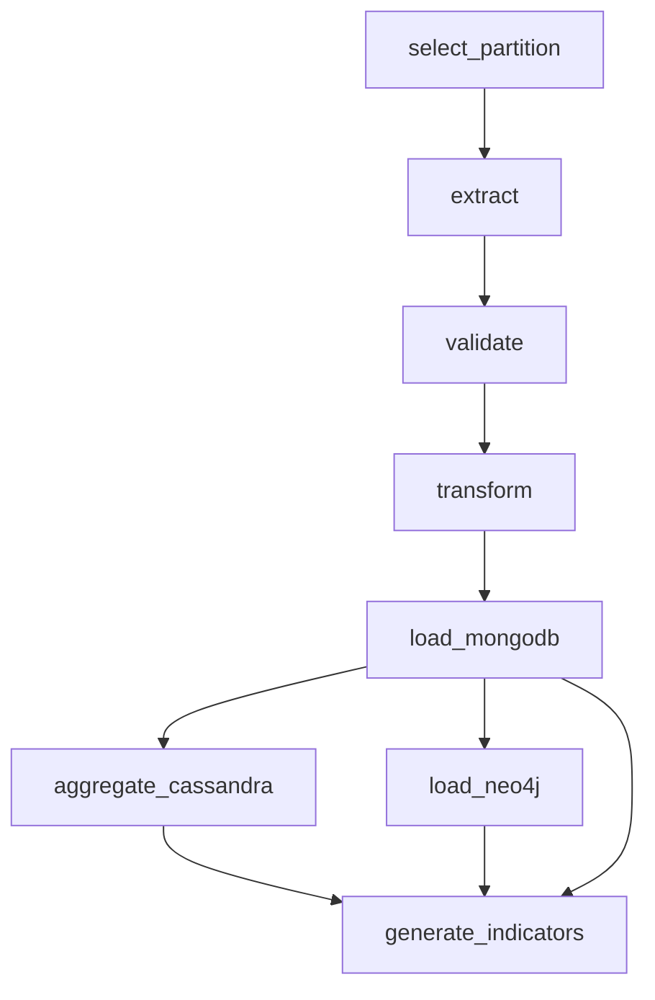

# Airflow local: DAG, archivos compartidos y verificación

Airflow 2.11.1 se ejecuta en Docker con Python 3.12 y un PostgreSQL de metadatos propio. Comparte red con las tres bases y monta `./data` del Mac en `/opt/gni/data`. La configuración de entrega está en `deploy/local.json`. La imagen parte de `apache/airflow:2.11.1-python3.12` y `requirements-pipeline.txt` fija los tres clientes de bases del pipeline.

## Flujo



Las ocho tareas usan TaskFlow. Las etapas de negocio están en `src/pipeline/tasks.py`; también pueden ejecutarse de forma secuencial con `python -m scripts.run_pipeline --date 20261027`.

## Programación y fecha de datos

- Cron: `0 6 * * *`, 06:00 UTC / 01:00 Lima.
- Se procesa el día anterior al **fin del intervalo** en UTC. Un intervalo que termina el 28 de octubre a las 06:00 procesa `20261027`.
- La configuración manual `{"target_date":"20261027"}` tiene prioridad.
- Hay dos reintentos separados por cinco minutos, una ejecución activa y `catchup=False`.
- El DAG se crea pausado. El cron está configurado, pero todavía falta activar y observar una ejecución disparada por el scheduler.

El Mac y Docker deben permanecer activos para ejecutar el cron. Las descargas nuevas necesitan Internet y dependen de la disponibilidad de GDELT.

## Almacenamiento y reintentos

`GNI_ARTIFACT_URI` solo admite una URI local absoluta `file:///ruta/compartida`. Compose establece `file:///opt/gni/data`. Desde terminal, si la variable no está definida, se usa `GNI_DATA_DIR` o el directorio `data/` del proyecto.

Los artefactos se guardan en `runs/FECHA/HASH_DEL_RUN_ID/`, separados por ejecución y estables en los reintentos. XCom contiene metadatos, conteos y rutas; los ZIP y JSONL permanecen en archivos. Cada tarea recupera su entrada en un directorio temporal y elimina esa copia al terminar. La publicación local copia a `.part` y renombra al completarse.

La transformación debe conservar el conteo validado. La carga documental comprueba el conteo MongoDB. Las ramas de agregación y grafo deben terminar antes de reconciliar volumen, frecuencias, tono y cantidades de nodos/aristas. Solo entonces se publica `reports/indicators.json` con los seis KPIs y se marca `pipeline_history` como `completed`.

Neo4j repite MERGE mediante `force=True`, incluso si hay historial previo completo. El contrato supone archivos diarios inmutables: no se eliminan relaciones obsoletas si cambia su contenido. El cargador conserva las primeras diez entradas por lista antes de deduplicar. El reemplazo Cassandra usa DELETE + INSERT y puede producir lecturas parciales durante una actualización.

## Arranque

Desde la raíz, conservar las credenciales existentes en `.env`:

```bash
python -m scripts.prepare_airflow

docker compose --env-file .env --env-file .airflow/local.env \
  -f compose.yaml -f compose.airflow.yaml build airflow

docker compose --env-file .env --env-file .airflow/local.env \
  -f compose.yaml -f compose.airflow.yaml up -d --wait --wait-timeout 600 airflow
```

La clave de PostgreSQL se genera en `.airflow/local.env`, ignorado por Git. Airflow usa `standalone` para la demostración local. Su interfaz está en http://localhost:8080; el usuario es `admin` y la contraseña generada se conserva en `/opt/airflow/standalone_admin_password.txt` dentro del contenedor. No incluirla en capturas o documentación.

## Importación y prueba completa

Comprobar las ocho tareas y dependencias:

```bash
docker compose --env-file .env --env-file .airflow/local.env \
  -f compose.yaml -f compose.airflow.yaml exec -T airflow \
  python -m scripts.check_airflow_dag
```

Ejecutar una partición y repetirla con otra fecha de ejecución:

```bash
docker compose --env-file .env --env-file .airflow/local.env \
  -f compose.yaml -f compose.airflow.yaml exec -T airflow \
  python -m scripts.check_airflow_dag --run --date 20261027 \
  --execution-date 2026-10-28T06:00:00+00:00 --output docs/airflow_verification_first.json

docker compose --env-file .env --env-file .airflow/local.env \
  -f compose.yaml -f compose.airflow.yaml exec -T airflow \
  python -m scripts.check_airflow_dag --run --date 20261027 \
  --execution-date 2026-10-29T06:00:00+00:00 --output docs/airflow_verification_repeat.json
```

`dag.test()` crea una ejecución real con la base de metadatos y ejecuta las tareas de forma serial. No sustituye la comprobación del scheduler. Las fechas son históricas a propósito: el campo de duración del DagRun puede calcularse desde esa fecha y no debe usarse como benchmark.

## Evidencias disponibles

Dos ejecuciones de la partición `20261027` terminaron con las ocho tareas en `success`. La repetición insertó cero documentos nuevos y conservó 84.723 registros, 707.104 relaciones HAS_THEME y 239.232 MENTIONS_ORG. Los agregados y KPIs se reconciliaron con MongoDB.

- [Primera ejecución](airflow_verification_first.json).
- [Repetición](airflow_verification_repeat.json).
- [Definición importada](airflow_dag_definition.json).
- [Diagrama exportado](airflow_dag.pdf).

La guía general de bases, dashboard y CRUD está en [ejecucion_local.md](ejecucion_local.md).

## Fuentes oficiales

- [Apache Airflow 2.11.1](https://airflow.apache.org/docs/apache-airflow/2.11.1/).
- [Airflow en Docker](https://airflow.apache.org/docs/apache-airflow/2.11.1/howto/docker-compose/index.html).

