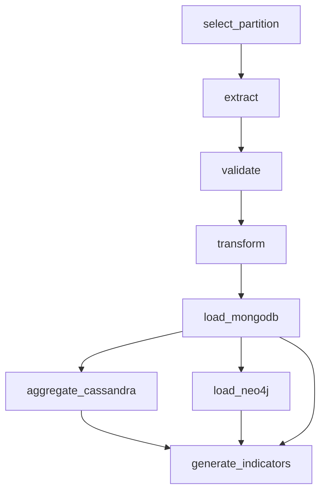

# Airflow local: DAG, archivos compartidos y verificación

Airflow 2.11.1 se ejecuta en Docker con Python 3.12 y un PostgreSQL de metadatos propio. Comparte red con las tres bases y monta `./data` del Mac en `/opt/gni/data`. La configuración de entrega está en `deploy/local.json`. La imagen parte de `apache/airflow:2.11.1-python3.12` y `requirements-pipeline.txt` fija los tres clientes de bases del pipeline.

## Flujo



Las ocho tareas usan TaskFlow. Las etapas de negocio están en `src/pipeline/tasks.py`; también pueden ejecutarse de forma secuencial con `python -m scripts.run_pipeline --date 20261027`.

## Programación y fecha de datos

- Cron: `0 6 * * *`, 06:00 UTC / 01:00 Lima.
- Se procesa el día anterior al **fin del intervalo** en UTC. Un intervalo que termina el 28 de octubre a las 06:00 procesa `20261027`.
- La configuración manual `{"target_date":"20261027"}` tiene prioridad.
- Hay dos reintentos separados por cinco minutos, una ejecución activa y `catchup=False`.
- El DAG se crea activo. Hay una ejecución real del scheduler verificada: `scheduled__2026-11-06T06:00:00+00:00`, con ocho tareas exitosas y 80.739 registros del 6 de noviembre reconciliados. Evidencia: [ejecución programada](airflow_scheduled_verification.json).

El Mac y Docker deben permanecer activos para ejecutar el cron. Las descargas nuevas necesitan Internet y dependen de la disponibilidad de GDELT.

## Almacenamiento y reintentos

`GNI_ARTIFACT_URI` solo admite una URI local absoluta `file:///ruta/compartida`. Compose establece `file:///opt/gni/data`. Desde terminal, si la variable no está definida, se usa `GNI_DATA_DIR` o el directorio `data/` del proyecto.

Los artefactos se guardan en `runs/FECHA/HASH_DEL_RUN_ID/`, separados por ejecución y estables en los reintentos. XCom contiene metadatos, conteos y rutas; los ZIP y JSONL permanecen en archivos. Cada tarea recupera su entrada en un directorio temporal y elimina esa copia al terminar. La publicación local copia a `.part` y renombra al completarse.

La transformación debe conservar el conteo validado. La carga documental comprueba el conteo MongoDB. Las ramas de agregación y grafo deben terminar antes de reconciliar volumen, frecuencias, tono y cantidades de nodos/aristas. Solo entonces se publica `reports/indicators.json` con los seis KPIs y se marca `pipeline_history` como `completed`.

Neo4j repite MERGE mediante `force=True`, incluso si hay historial previo completo. El contrato supone archivos diarios inmutables: no se eliminan relaciones obsoletas si cambia su contenido. El cargador conserva las primeras diez entradas por lista antes de deduplicar. Cassandra calcula todos los KPIs en una sola lectura de MongoDB, escribe y verifica una generación nueva y solo después publica la fila de métricas con su UUID. Un fallo previo conserva la versión visible anterior. El DAG invoca una sola agregación por fecha. Guía y prueba de recuperación: [Cassandra](cassandra_recovery.md).

## Arranque

Desde la raíz, conservar las credenciales existentes en `.env`:

```bash
docker compose up -d --build --wait --wait-timeout 600
```

Este comando levanta las bases, Airflow y el dashboard desde el único `compose.yaml`. Airflow ejecuta `python -m scripts.bootstrap_databases` antes de iniciar el scheduler; el script se puede repetir y no borra registros. El DAG queda activo por defecto, con una extracción diaria a las 06:00 UTC (01:00 Lima) y `catchup=False`. Solo el usuario web de Airflow requiere credenciales configuradas: `AIRFLOW_ADMIN_USERNAME` y `AIRFLOW_ADMIN_PASSWORD`. La comunicación interna con PostgreSQL y Neo4j está sin autenticación en este stack local. La interfaz está en http://localhost:8080 y el dashboard en http://localhost:8501.

## Importación y prueba completa

Comprobar las ocho tareas y dependencias:

```bash
docker compose exec -T airflow \
  python -m scripts.check_airflow_dag
```

Ejecutar una partición y repetirla con otra fecha de ejecución:

```bash
docker compose exec -T airflow \
  python -m scripts.check_airflow_dag --run --date 20261027 \
  --execution-date 2026-10-28T06:00:00+00:00 --output docs/data-utils/airflow_verification_first.json

docker compose exec -T airflow \
  python -m scripts.check_airflow_dag --run --date 20261027 \
  --execution-date 2026-10-29T06:00:00+00:00 --output docs/data-utils/airflow_verification_repeat.json
```

`dag.test()` crea una ejecución real con la base de metadatos y ejecuta las tareas de forma serial. No sustituye la comprobación del scheduler. Las fechas son históricas a propósito: el campo de duración del DagRun puede calcularse desde esa fecha y no debe usarse como benchmark.

## Evidencias disponibles

Dos ejecuciones de la partición `20261027` terminaron con las ocho tareas en `success`. La repetición insertó cero documentos nuevos y conservó 84.723 registros, 707.104 relaciones HAS_THEME y 239.232 MENTIONS_ORG. Los agregados y KPIs se reconciliaron con MongoDB.

- [Primera ejecución](airflow_verification_first.json).
- [Repetición](airflow_verification_repeat.json).
- [Definición importada](airflow_dag_definition.json).
- [Diagrama exportado](airflow_dag.pdf).

La guía general de bases, dashboard y CRUD está en [ejecucion_local.md](ejecucion_local.md).

## Fuentes oficiales

- [Apache Airflow 2.11.1](https://airflow.apache.org/docs/apache-airflow/2.11.1/).
- [Airflow en Docker](https://airflow.apache.org/docs/apache-airflow/2.11.1/howto/docker-compose/index.html).

## Verificación de una ejecución programada

El verificador siguiente consulta los metadatos de Airflow y acepta únicamente
una ejecución de tipo `scheduled`, con las ocho tareas exitosas, historial
`completed` y reconciliación vigente de las tres bases. Si la ejecución sigue en
curso o falló, termina con error sin generar una evidencia nueva.

```bash
docker compose exec -T airflow \
  python -m scripts.verify_scheduled_run \
  --output docs/data-utils/airflow_scheduled_verification.json
```

Se puede indicar `--run-id` para verificar una ejecución programada concreta.
Sin ese argumento se comprueba la más reciente, aunque todavía esté en curso.

### Reinicio del servidor web

El volumen de Airflow conserva `airflow-webserver.pid` al detener Docker. Se
observó que ese PID obsoleto impedía iniciar Gunicorn aunque el scheduler seguía
procesando tareas. El comando de arranque de Compose elimina únicamente ese
archivo antes de ejecutar `airflow standalone`, cuando aún no hay servidor web
activo dentro del nuevo arranque. No elimina metadatos ni datos del pipeline.
